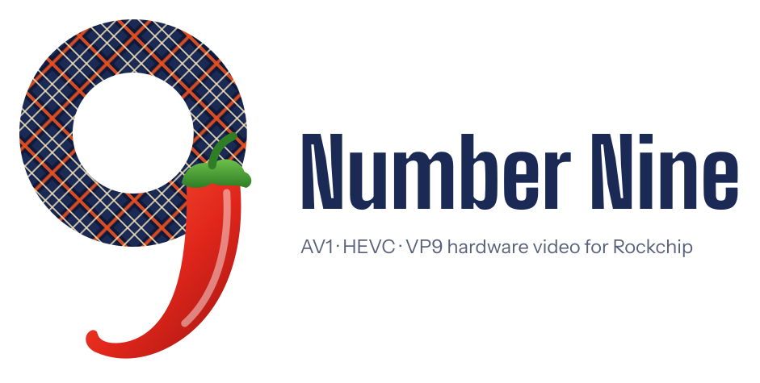

<p align="center">
  <picture>
    <source media="(prefers-color-scheme: dark)" srcset="docs/branding/number-nine-lockup-dark.svg">
    
  </picture>
</p>

# rockchip-vaapi

*Number Nine* is this project's name, a tribute to the 1980s graphics-card maker; not affiliated with or endorsed by
Number Nine, the successors to its assets, or Rockchip.

VA-API driver for Rockchip RK3588 / RK3576 that bridges **libva** to
**librockchip-mpp** (MPP), enabling hardware-accelerated video decode in
applications such as Firefox.

**Author:** Eduardo García-Mádico Portabella — EGP Sistemas
**Contact:** woodyst@gmail.com
**License:** LGPL-2.1-or-later (the logo in docs/branding/ excepted)

---

## What it does

The Rockchip RK3588 SoC includes dedicated video decoders for H.264, HEVC,
VP8, VP9 and AV1. However, no vendor-supplied VA-API driver exists for them. This project fills that gap by implementing the complete
`VADriverVTable` (VA-API 1.20) and forwarding decode work to the Rockchip MPP
library, which in turn uses the hardware VPU.

Key features:

- H.264, HEVC, VP8, VP9 and AV1 hardware decode, 8- and 10-bit (AV1 since v3.0.0 "Plaid Number Nine", see below)
- Zero-copy DRM PRIME 2 surface export (NV12 and P010, DMABUF)
- Fixes for several decoders on one VA display, multi-threaded clients and players that
  abandon decoders early (Firefox's media process, ffmpeg 8, mpv) in v2.5.0 — see KI-12
- 4K60 AV1 in Firefox (v3.5.0 "Pepper SGT"): one AV1-engine job per picture with Plaid Pi's MPP `+pd32` or later (other MPP builds re-decode, [known issue KI-14](KNOWN-ISSUES.md#ki-14-av1-decoded-twice-per-early-synced-picture-without-plaid-pis-mpp-v350)), 8-bit zero-copy
  export, a per-decoder output thread instead of a 1 ms polling sync; in Chrome/Chromium no more green or old frames
  at playback start and quality switches (see below, KI-15 and KI-16)
- H.264 and HEVC parameter sets rebuilt per picture with the streams' scaling lists, H.264 field pictures and CAVLC
  multi-slice, the HEVC slice-header rewrite for SPS-level reference sets, the High 10 initial QP, and a safe AV1
  resolution change (v4.0.0 "Pepper Pro"): JVT-AVC_V1 111/135, JVT-FR-EXT 69/69, JCT-VC-HEVC_V1 141/147 bit-exact
- Compatible with Firefox 128+ (VA-API PDM path, RDD process)
- Implements the full VA-API 1.20 vtable (`__vaDriverInit_1_20`)

## Supported hardware

| SoC | Board (tested) |
|-----|---------------|
| RK3588 | Orange Pi 5 Plus |
| RK3588S | Orange Pi 5B (tested); Orange Pi 5 / Rock 5B (should work) |
| RK3576 | Likely compatible (untested) |

## Supported codecs

This driver advertises only what has been verified to decode correctly on
hardware. Anything not listed here is deliberately **not** offered to clients,
so players and media servers fall back to paths that work (software decode,
server-side transcode) instead of rendering a broken picture.

| Codec | Profile | Status |
|-------|---------|--------|
| H.264 | Constrained Baseline, Main, High | ✅ hardware decode (B-frame routing fixed in v2.1.2, KI-1). v4.0.0: custom scaling matrices, interlaced streams, per-picture PPS changes and CAVLC multi-slice pictures fixed — JVT-AVC_V1 111/135 and JVT-FR-EXT 69/69 bit-exact (74 and 27 in 3.5.0); KI-17, KI-20, KI-21 (the last two mostly: POC type 1 and FMO/ASO/SP stay open) |
| VP8   | Version 0–3 | ✅ advertised |
| VP9   | Profile 0 (8-bit) | ✅ hardware decode, including non-16-aligned widths |
| H.264 | High10 | ✅ advertised since v2.1.3; v4.0.0: the two conformance vectors (FREH10-1/2) decode bit-exact through ffmpeg — scaling matrices, and the initial QP that ffmpeg hands over with the bit-depth offset added (KI-17; the Chromium/GStreamer recognition is by command line and symbols, not yet seen on a live stream). Firefox 157 decodes High 10 on the hardware through this path (measured 2026-10-25); Chromium offers High 10 H.264 to software only |
| HEVC  | Main (8-bit) | ✅ hardware decode, advertised (v2.1.0+). v4.0.0: slices that use SPS-level reference-picture sets are rewritten with inline sets, and the PPS is rebuilt per picture with the stream's scaling lists (KI-5, KI-22) — JCT-VC-HEVC_V1 141/147 bit-exact on 2026-10-25 (17 in 3.5.0); the remaining 6 are listed in KI-5 |
| HEVC  | Main10 | ✅ hardware decode + zero-copy display, advertised since v2.1.3 (mpv and Firefox verified; see KI-3 for the history); the KI-5 and KI-22 fixes apply |
| VP9   | Profile 2 (10-bit) | ✅ hardware decode + zero-copy display, advertised since v2.1.3 |
| AV1   | Main (Profile 0), 8- and 10-bit | ✅ hardware decode since v3.0.0 "Plaid Number Nine": the driver rebuilds the OBU headers MPP needs from the VA-API parameters; matches the Fluster reference checksums on 215/242 libaom and 34/36 Chromium conformance vectors with a `+pd35` MPP build (213 and 31 with an older MPP: the difference is the film-grain vectors), the rest explained in KI-13. v4.0.0: a mid-stream resolution increase no longer corrupts memory — exporting players get a surface of the new size, downloading clients a clean refusal (KI-13) |

Releases before v2.0.0 advertised HEVC, High10 and VP9 Profile 2 without decoding
them correctly — see [KNOWN-ISSUES](KNOWN-ISSUES.md) for the full story.

> **Panthor / Panfrost GPU stacks (mainline Mesa):** libva auto-detects the driver from v2.1.5 (shipped `panthor_drv_video.so` / `panfrost_drv_video.so` symlinks); on older versions set `LIBVA_DRIVER_NAME=rockchip`. See KI-9.
>
> **Menu switches:** `RKVA_HIDE_10BIT=1` hides the three 10-bit profiles again if a client cannot present P010, and
> from v3.0.0 it also makes every profile 8-bit only (no P010 surfaces, a 10-bit AV1 picture is refused), because
> 8- and 10-bit AV1 share one profile. `RKVA_HIDE_AV1=1` hides AV1. Any value hides, even `0`; leave the variables
> unset to keep everything.
>
> **Browsers:** Firefox, Chrome and Chromium can all decode through this driver over VA-API; which codecs a page is
> offered also depends on the browser's own build and settings. Chromium builds that decode through libv4l-rkmpp
> (V4L2) do not use it (KI-6). On Arm's proprietary Mali GL driver, unpatched Firefox and mpv's zero-copy path draw
> 10-bit near-black — see KI-11 for the fixes.

### AV1

AV1 is the one codec where VA-API and MPP disagree about who parses the headers: clients hand the driver parsed
picture parameters plus the tile payloads, MPP wants a complete OBU stream. `src/av1.c` writes that stream back —
sequence header, frame header, tile-group framing — with a vendored copy of GStreamer's AV1 bit writer
(`src/av1/`, five bugs fixed and segmentation implemented, see [docs/DEVELOPMENT.md](docs/DEVELOPMENT.md)). The one value VA-API never passes, `refresh_frame_flags`, is read
from the next picture's reference map, so every picture is held until its successor arrives (or until the client
syncs it, when it is decoded at once; with Plaid Pi's patched MPP — librockchip-mpp1 `+pd32` and later, RK3588 —
MPP keeps that decode and stores it into the right slots afterwards, otherwise the slot refresh follows as a second,
hidden decode: one extra AV1-engine job per such picture, see [KI-14](KNOWN-ISSUES.md#ki-14-av1-decoded-twice-per-early-synced-picture-without-plaid-pis-mpp-v350)). Conformance measured through
`ffmpeg -hwaccel vaapi` (see `evidence/2026-10-11-av1-fluster/`); decode on the AV1 engine confirmed by interrupt
counts in Chrome, Firefox and mpv, the picture checked by eye in Chrome and Firefox.
Film grain is applied by the hardware when MPP has the one-line fix from rockchip-mpp issue #974 (a `+pd35` build of Plaid
Pi's MPP — `+pd34` is the current download, `+pd35` follows with Plaid Pi 6.0 — and the pull request we have prepared upstream); with an older MPP, grainy streams decode to the clean picture. `RKVA_AV1_NO_GRAIN=1` turns
the grain off for a decode (the player can then apply its own).
`RKVA_AV1_WRITER_DEBUG=1` prints the bit writer's warnings (`2` adds its debug trace), `RKVA_DUMP_AV1=file` saves the stream sent to MPP.
AV1 needs MPP's `av1d` and the RK3588's AV1 decoder (RK356x has none); film grain depends on MPP (#974).
Releases are named after Number Nine's Pepper boards, co-processor graphics cards of the late 1980s — this driver's
whole job is handing video work to a co-processor. 3.0.0 was "Plaid Number Nine"; 3.5.0 was "Pepper SGT", after the
board of that name (1987: a TMS34010 beside an Intel 82786, 1–4 MB, ISA); 4.0.0 is "Pepper Pro", after the series that
followed it (Pepper Pro 1024, 1280 and 1600, 1988–1990, TMS34010; the 1024 shipped with 1.5–2 MB in ISA and MCA versions). The name is a tribute; this
project is not affiliated with or endorsed by Number Nine or the successors to its assets.

## Dependencies

Runtime:
- `libva2` (>= 2.20; the driver exports only the 1.20 init entry point)
- `librockchip-mpp1` (any ≥ 1.5.0 decodes every codec, but the Ubuntu-Rockchip PPA builds lose frames in VP9 sessions
  past ~65,536 frames, KI-10; for that, and for 4K60 AV1 in Firefox and clean AV1 last frames in Chrome, KI-14/15, use
  Plaid Pi's MPP build, published for Ubuntu 24.04 and 26.04 at https://github.com/defcom5-rockchip/mpp/releases/tag/pd34)
- `librga2` (the RK3588 2D engine, used for the 10-bit conversion)

Build:
- `libva-dev`
- `librockchip-mpp-dev`
- `librga-dev` — required by default: `make` stops if librga is missing. `make RGA=no`
  builds without it, and 10-bit is then converted on the CPU.
- `pkg-config`, `gcc`

## Quick start

```bash
# Build (needs librga-dev, or: make RGA=no) and install
make
sudo make install

# Launch Firefox with hardware decode
LIBVA_DRIVER_NAME=rockchip \
LIBVA_DRIVERS_PATH=/usr/lib/aarch64-linux-gnu/dri \
MOZ_DISABLE_RDD_SANDBOX=1 \
firefox
```

`MOZ_DISABLE_RDD_SANDBOX=1` turns off the sandbox of Firefox's media decoding process. The
Debian package sets these variables system-wide by default, for every user (its debconf question
has medium priority, so apt does not show it). To turn them off: `sudo dpkg-reconfigure
rockchip-vaapi` and answer No.

In Firefox, also enable via `about:config`:

| Preference | Value |
|-----------|-------|
| `media.hardware-video-decoding.enabled` | `true` |
| `media.ffmpeg.vaapi.enabled` | `true` |
| `media.rdd-ffmpeg.enabled` | `true` |

## Verifying hardware decode

The driver logs only when `RK_VAAPI_LOG` names a file:

```bash
RK_VAAPI_LOG=/tmp/rk-vaapi.log LIBVA_DRIVER_NAME=rockchip MOZ_DISABLE_RDD_SANDBOX=1 firefox
# play a video, then:
grep -E 'mpp_init OK|EndPicture|ExportSurfaceHandle' /tmp/rk-vaapi.log | head
```

While a video plays, the player must hold the decoder device:

```bash
sudo fuser -v /dev/mpp_service   # lists Firefox's RDD process, Chrome's GPU process, mpv, …
```

## Permanent Firefox launcher

Create `/usr/local/bin/firefox-hw`:

```bash
#!/bin/sh
export LIBVA_DRIVER_NAME=rockchip
export LIBVA_DRIVERS_PATH=/usr/lib/aarch64-linux-gnu/dri
export MOZ_DISABLE_RDD_SANDBOX=1
exec /usr/bin/firefox "$@"
```

```bash
chmod +x /usr/local/bin/firefox-hw
```

## Development

See [docs/DEVELOPMENT.md](docs/DEVELOPMENT.md) for architecture, VA-API
internals, MPP integration details, and how to add support for new codecs.

## AI-assisted development

This driver was designed and implemented with the assistance of
**Claude Sonnet 4.6** (model ID: `claude-sonnet-4-6`), an AI model developed
by Anthropic. Total interactive development time: approximately **3–4 hours**
across two sessions (24 April 2026).

The AI assisted with: architecture design, VA-API vtable implementation,
H.264 Annex B SPS/PPS reconstruction via Exp-Golomb encoding, MPP API
integration, DMABUF/DRM PRIME 2 surface export, and iterative debugging of
Firefox integration issues.

All code was reviewed, tested, and validated on real hardware by
Eduardo García-Mádico Portabella — EGP Sistemas.

### Fork additions — defcom5-rockchip

This fork (`defcom5-rockchip/rockchip-vaapi`) builds on the base driver above, adding:

- **truongsinh's PR #2** (chroma-plane re-stride into the exported layout, optional RGA
  blit offload, RTFormat / surface-attribute reporting) — previously unmerged upstream.
- **VP9 unaligned-width fix** — 64-align the exported surface stride so VP9 streams whose
  coded width is not a multiple of 16 (e.g. 2970×2160@25, 1.375:1 Academy-ratio content)
  no longer render as a solid green frame. See [REPRO.md](REPRO.md).

- **AV1 decode (v3.0.0 "Plaid Number Nine")** — `src/av1.c`/`av1.h`, the `do_av1_decode` submit policy
  (refresh_frame_flags deferral, early decode on sync, synthesised show_existing, hidden KEY as INTRA_ONLY,
  film-grain surface routing), the six fixes to the vendored GStreamer AV1 bit writer in `src/av1/` and the
  `tests/av1/` harness were written by Claude (Opus 5.5 and Fable 5.1) in pair sessions; defcom5-rockchip set the
  design constraints, ran every measurement on the Orange Pi 5B and reviewed each change. Fluster results and the
  attribution table are in `evidence/2026-10-11-av1-fluster/`.
- **H.264 and HEVC conformance (v4.0.0 "Pepper Pro")** — per-picture PPS with the streams' scaling lists for both
  codecs, H.264 field pictures and CAVLC multi-slice, the High 10 initial-QP correction with client recognition, the
  HEVC slice-header rewrite with inline reference picture sets (`src/hevc.c`), and the AV1 surface growth/refusal on a
  resolution change; written by Claude (Fable 5.1) in pair sessions under the same division of work, every change
  measured on the Orange Pi 5B against Fluster and real players. Evidence in `evidence/2026-10-25-*/`.

These fork additions were developed with the assistance of **Claude (Fable 5)** and were
reviewed, tested, and validated on real hardware — **Orange Pi 5B (RK3588S)**, Arm's Mali driver (libmali g24p0) and, earlier, panfork
Mesa 23, Firefox 154 VA-API — by **defcom5-rockchip**. (The base-driver validation credit
above belongs to Eduardo García-Mádico Portabella; it does not cover these fork additions.)

## License and attribution

**LGPL-2.1-or-later** — see [LICENSE](LICENSE). Per-file copyright is recorded in
[debian/copyright](debian/copyright); the driver sources carry SPDX identifiers.
The Number Nine logo in [docs/branding/](docs/branding/) is not under the LGPL. It is © 2026 defcom5-rockchip, all
rights reserved; it may be used unmodified to refer to this project (details in its README).

This is a fork, and the lineage matters:

- **Eduardo García-Mádico Portabella** (`woodyst`) wrote the original driver —
  the VA-API vtable, the MPP plumbing, the H.264 parameter-set reconstruction and
  the H.264 bit writer (`bs.h`) this fork still builds on. Upstream: https://github.com/woodyst/rockchip-vaapi
- **truongsinh** contributed the surface-stride fixes carried here from upstream PR #2.
- **The GStreamer project** — `gstav1bitwriter.c`/`.h` (Intel, He Junyan, 2022) and `gstav1parser.h` (Georg
  Ottinger, Intel), LGPL-2.0-or-later / LGPL-2.1-or-later, vendored in `src/av1/` from GStreamer 1.28.2 with six
  marked changes (`src/av1/README`). The AV1 path is built on them.
- **defcom5-rockchip** maintains this fork: the HEVC bitstream assembler (`src/hevc.c`,
  original work — upstream has no HEVC), the NV15 to P010 repack with its NEON path,
  B-frame and reference-routing fixes, `vaDeriveImage`, the honest profile
  advertisement, the AV1 OBU re-serialiser (`src/av1.c`, v3.0.0), the per-picture H.264/HEVC parameter sets and the
  HEVC slice-header rewrite (v4.0.0), and the test tooling. Developed with Claude as co-engineer;
  contributions are attributed in the commit trailers.

Rockchip MPP, libva and the other libraries this links against carry their own
licenses and are not redistributed here.

## Contributors

| who | what |
|---|---|
| **Eduardo García-Mádico Portabella** (`woodyst`) | original driver: VA-API ↔ MPP bridge, H.264 path, the H.264 bit writer this fork builds on |
| **TruongSinh Tran-Nguyen** (`truongsinh`) | surface-stride fixes (upstream PR #2) |
| **GStreamer project** (Intel / He Junyan, Georg Ottinger) | the AV1 bit writer and parser headers vendored in `src/av1/` |
| **defcom5-rockchip** | fork maintainer: 10-bit zero-copy (GR1616 fix), Main10/High10/VP9 P2, Chrome created-depth export, Panthor/Panfrost libva names, the RGA3 NV15→P010 export lane, AV1 (v3.0.0), the H.264/HEVC conformance work (v4.0.0), the KI test ladder, releases — and the RK3588 kernel-side fixes that surfaced along the way (Armbian `linux-rockchip` PR #548) |
| **Claude** (Anthropic) — Opus 5.5, Fable 5.1, Fable 5, Opus 5, Sonnet 4.6 | co-engineer on the fork, credited per commit in the `Co-Authored-By` trailers: root-cause work, patches, test tooling and the documentation |
| An Armbian forum tester (RK3588 Orange Pi 5 Plus / Armbian vendor kernel) | confirmed Chrome 10-bit HEVC and VP9 Profile 2 hardware playback with 2.1.5, measured the 2.2.0-rc1 RGA lane (97 → 1 dropped frames at 4K60 HDR), and reported the Panthor libva naming that became the shipped symlinks |
| **nyanmisaka** (`ffmpeg-rockchip`, `jellyfin-ffmpeg`) | the RGA3 P010 recipe (`RK_FORMAT_YCbCr_420_SP_10B` + the 10-bit flags) the export lane follows, and the Rockchip lanes in Jellyfin's FFmpeg |

## RGA export lane (10-bit)

Since 2.2.0, a build with librga does the per-frame copy into the exported surface on the
RK3588's RGA3 2D engine for 10-bit streams too: MPP's packed NV15 is converted to
true P010 in hardware (same `RK_FORMAT_YCbCr_420_SP_10B` on both sides,
`is_10b_compact = is_10b_endian = 1` on the P010 side, byte-pitch strides),
verified bit-exact against the previous CPU repack on 4K HDR10 content.
At 3840x2160 the blit takes about 3.8 ms on one RGA3 core and removes about
5 s of CPU time per 20 s of 4K60 playback from the decoding process.
`RKVA_RGA_P010=0` forces the CPU repack for 10-bit. The 8-bit NV12 copy stays on the CPU by default (as in 2.1.5); `RKVA_RGA_COPY=1` enables it, `RKVA_RGA_COPY=0` turns every RGA copy off for A/B tests.
Since 3.5.0 a client that exports each surface after decoding (Firefox, mpv `hwdec=vaapi`) gets 8-bit frames without
any copy: the driver exports MPP's own buffer when its stride is 64-aligned and keeps it until the surface is reused
(`RKVA_ZERO_COPY=0` turns this off). Chromium, vaapi-copy and ffmpeg's download path keep the copy.
`RKVA_SYNC_POLL=1` brings back the 1 ms polling vaSyncSurface of 3.0.0 instead of the per-decoder output thread
(AV1 pacing, below, then polls too).
AV1 pictures go to MPP from a per-decoder thread, so vaEndPicture returns before the picture is decoded. A client that
never waits on its pictures (Chromium syncs each surface once, when it imports it) is paced instead: vaEndPicture returns
once the picture from two pictures earlier is in its surface, about what 3.0.0 had (`RKVA_PACE=n` changes the depth,
`0` turns pacing off and brings Chromium's old-picture and green flashes back). For a client that imports its surfaces
before decoding into them (Chromium, GStreamer) a new decoder — playback start, every YouTube quality step — decodes
its first 25 shown pictures before vaEndPicture returns (`RKVA_PACE_START=n`, `RKVA_PACE_START_MS=n` adds a time floor),
which removed the green/old-frame flicker 3.0.0 showed there (none seen in 10 measured first plays, with Plaid Pi's MPP); with Plaid Pi's MPP
every later shown picture is decoded at once too, so the last frame of a stream is right (KI-15). A rare old frame can
still show mid-stream when Chromium runs out of decoded pictures (KI-16, as in 3.0.0).

### Environment switches

All default to the tested behaviour; set one only to diagnose a problem. Any value counts as "set", including `0`,
unless a value is listed.

| Variable | Default | Effect | When to use |
|---|---|---|---|
| `RK_VAAPI_LOG=file` | off | per-call log with timings; "deferred refresh available" shows the patched MPP is in use | any report |
| `RKVA_HIDE_10BIT` | off | hide the 10-bit profiles | a client that cannot present P010 |
| `RKVA_HIDE_AV1` | off | hide AV1 | an AV1 problem you want to route around |
| `RKVA_ZERO_COPY=0` | on | 8-bit frames are copied into the surface instead of exporting MPP's buffer | a client that shows a stale 8-bit picture |
| `RKVA_SYNC_POLL=1` | off | the 1 ms polling vaSyncSurface of 3.0.0 instead of the output thread | to compare with 3.0.0 |
| `RKVA_PACE=n` (0–7) | 2 | AV1 pacing depth for clients that never wait on a picture; `0` = off | Chromium old-picture/green flashes |
| `RKVA_PACE_START=n` (0–64, or `all`) | 25 | shown pictures a new decoder decodes before vaEndPicture returns; `all` = every picture | start/switch flicker vs dropped frames |
| `RKVA_PACE_START_MS=n` (≤ 10000) | 0 | the start window also lasts at least this long | slow starts |
| `RKVA_AV1_NO_DEFER` | off | never use MPP's deferred refresh (always re-decode) | to compare with other MPP builds |
| `RKVA_RGA_P010=0` / `RKVA_RGA_COPY=1` | RGA for 10-bit, CPU for 8-bit | choose the copy engine | RGA problems |
| `RKVA_AV1_WRITER_DEBUG=1`/`2`, `RKVA_DUMP_AV1=file` | off | AV1 bit-writer warnings / dump the stream sent to MPP | AV1 stream problems |
| `RKVA_DUMP_H264=file`, `RKVA_DUMP_HEVC=file` | off | dump the H.264 / HEVC stream sent to MPP (our headers, the client's slices) | H.264/HEVC stream problems |
| `RKVA_H264_INITQP=coded`/`ffmpeg` | recognised: Chromium and GStreamer = coded, others = ffmpeg | whether the client hands over High 10 `pic_init_qp` with the bit-depth offset added (KI-17) | a High 10 picture slightly off in a client the guess gets wrong |

All of this needs the driver to be built against librga. The v2.2.0 release download was
built without it (it does not link `librga.so.2`), so on that build 10-bit always used the
CPU repack. From v2.5.0 the build stops when librga is missing unless `RGA=no` is given,
and the package depends on `librga2`.

